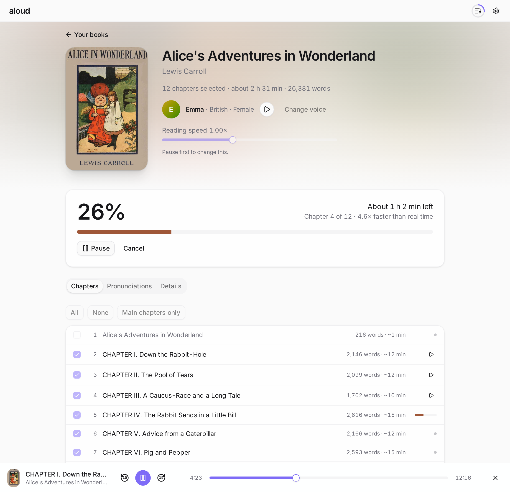
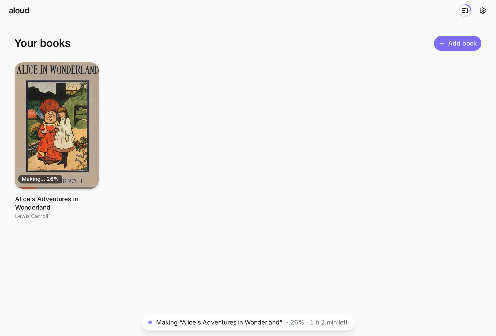
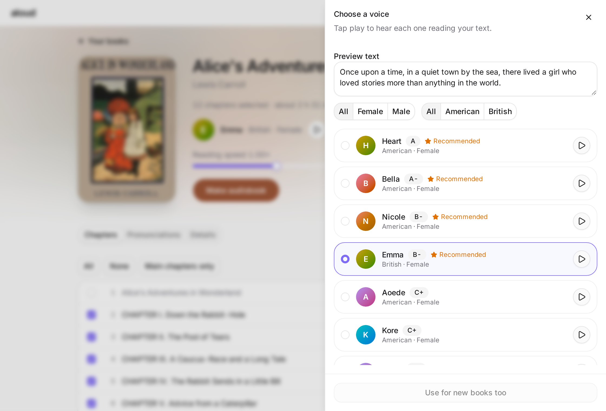
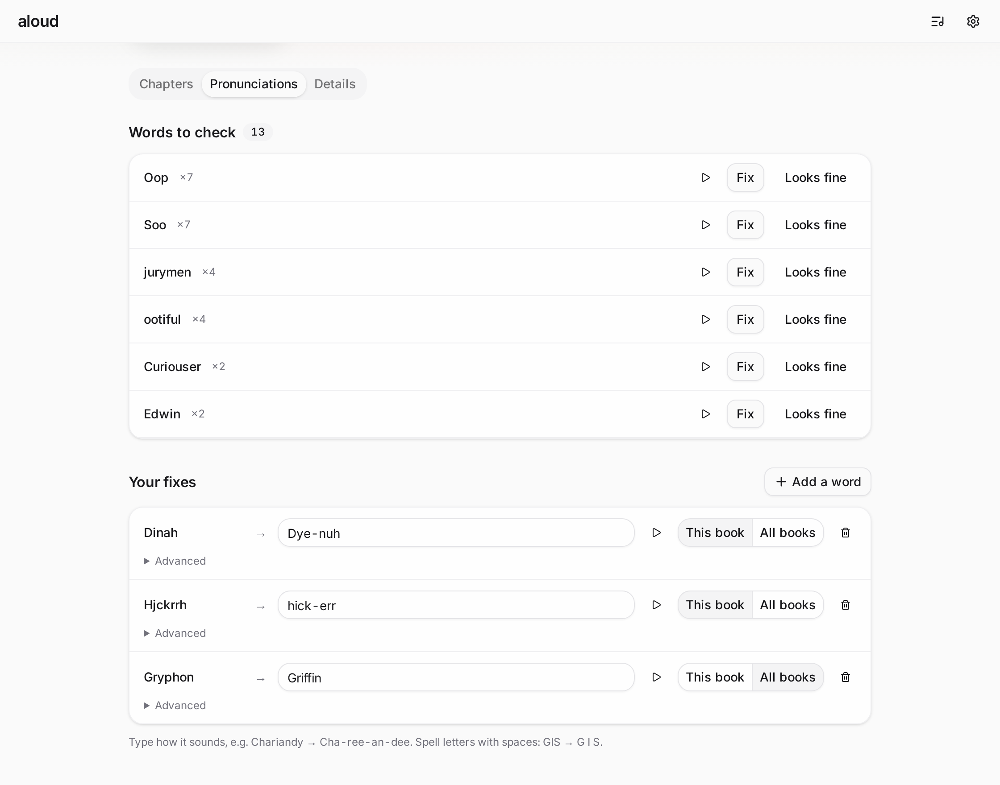
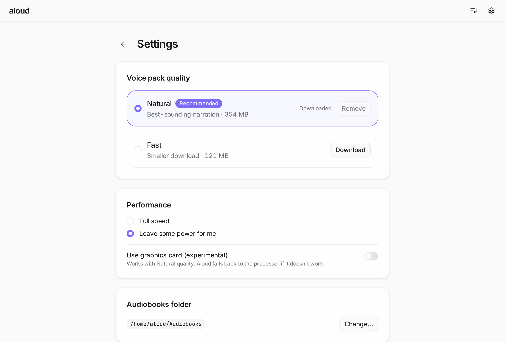

<p align="center">
  
</p>

<h1 align="center">Aloud</h1>

<p align="center">
  <a href="https://github.com/suft/aloud/actions/workflows/ci.yml"></a>
  <a href="https://github.com/suft/aloud/releases/latest"></a>
  
  <a href="LICENSE"></a>
</p>

Turn a DRM-free English EPUB into a chaptered `.m4b` audiobook. Everything runs on your
computer with the [Kokoro-82M](https://huggingface.co/hexgrad/Kokoro-82M) voice model; nothing is uploaded.

<picture>
  <source media="(prefers-color-scheme: dark)" srcset="docs/screenshots/book-dark.png">
  
</picture>

- Resumable renders: closing the app never loses finished parts.
- Voice picker with spoken preview, reading speed, spoken title/author introduction.
- Per-chapter selection, editable title/author/cover.
- Pronunciation dictionary and a "words to check" finder; changing a word re-renders only the sentences that contain it.
- Built-in player, ETA, pause/cancel, multi-book queue, keep-awake and a "leave some power for me" mode.
- Optional (experimental) graphics-card acceleration.

English books only; output is always M4B (AAC).

## Screenshots

<table>
  <tr>
    <td width="50%">
      <picture>
        <source media="(prefers-color-scheme: dark)" srcset="docs/screenshots/library-dark.png">
        
      </picture>
      <br>Library
    </td>
    <td width="50%">
      <picture>
        <source media="(prefers-color-scheme: dark)" srcset="docs/screenshots/voices-dark.png">
        
      </picture>
      <br>Voice picker
    </td>
  </tr>
  <tr>
    <td width="50%">
      <picture>
        <source media="(prefers-color-scheme: dark)" srcset="docs/screenshots/pronunciations-dark.png">
        
      </picture>
      <br>Pronunciations
    </td>
    <td width="50%">
      <picture>
        <source media="(prefers-color-scheme: dark)" srcset="docs/screenshots/settings-dark.png">
        
      </picture>
      <br>Settings
    </td>
  </tr>
</table>

## Install

Download the installer for your system from the [Releases](../../releases) page.

The builds are not code-signed:

- **macOS** (Apple Silicon): right-click the app, choose **Open**, then confirm. Intel Macs are not supported
  because ONNX Runtime ships no Intel macOS build.
- **Windows**: when SmartScreen appears, click **More info → Run anyway**.
- **Linux**: AppImage or `.deb`.

On first launch Aloud offers two voice packs: **Natural** (354 MB download, best sound) and **Fast** (121 MB).
Your Mac's or PC's processor does the work; the voice packs are downloaded once from GitHub and checked against fixed checksums.

Aloud checks GitHub for a newer release at launch (at most once a day) and shows an **Update** button in the header
when one is available; updates are signed and verified before they are installed. Turn the automatic check off, or
check by hand, in **Settings → About**.

## Develop

Tools are managed with [mise](https://mise.jdx.dev). System packages on Linux: `webkit2gtk-4.1`, `alsa-lib`,
`libclang`, `libc++`.

```sh
mise install && mise run setup && mise run dev
```

| Task                    | What it does                                                                 |
| ----------------------- | ---------------------------------------------------------------------------- |
| `mise run dev`          | Run the app with hot reload (`ALOUD_DATA_DIR=<dir>` keeps dev data separate) |
| `mise run build`        | Build installers into `target/release/bundle/`                               |
| `mise run test`         | Rust tests and `svelte-check`                                                |
| `mise run lint` / `fmt` | clippy, rustfmt, prettier                                                    |
| `mise run models`       | Download the models and a public-domain test book into `.dev-data/`          |
| `mise run e2e`          | Render two chapters of the test book with the CLI example                    |
| `mise run smoke`        | Render a tiny generated EPUB end to end (fast model; CI runs this)           |
| `mise run screenshots`  | Regenerate the README screenshots (headless Chromium, mocked backend)        |

The Rust core (`crates/aloud-core`) has no UI dependency. `crates/aloud-core/examples/aloud.rs` is a CLI over the
same render service (`--list`, `--chapters 1-3`, `--voice`, `--pron "word=sounds like"`, `--bench`).

## License

GPL-3.0-or-later, because espeak-ng is linked statically. Kokoro-82M (Apache-2.0), misaki (Apache-2.0/MIT),
ONNX Runtime (MIT).
